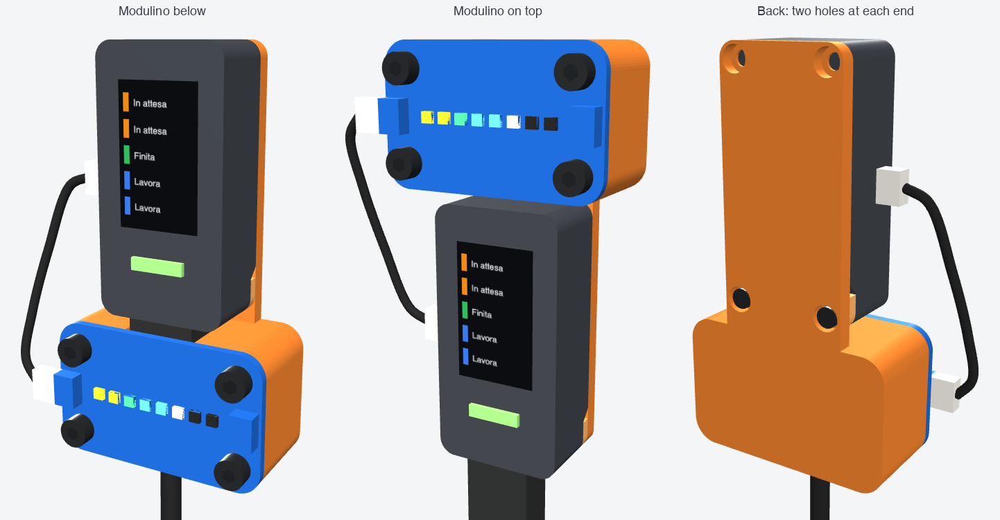

# Back shell for the Nesso N1 and a Modulino Pixels



A 3D-printed shell that takes the place of the Nesso N1's antenna storage and
holds a [Modulino Pixels](https://docs.arduino.cc/hardware/modulino-pixels/)
next to the screen. The Nesso always stays upright, with the USB-C cable going
down. The shell goes on either way round:

- **Modulino below.** The LED bar sits under the USB-C end. The USB-C plug and
  its cable run through a channel behind it.
- **Modulino on top.** Turn the shell 180° in the plane of the screen, and the
  LED bar sits above the other end. The USB-C cable then comes out freely
  below.

The Nesso has screw holes and a 2 mm recess in its back only at the USB-C end.
So the shell has two holes at each end, and you use the pair that lands at the
USB-C end. A separate spacer fills the recess under that end.

## What you need

- The two printed parts: `stl/shell.stl` and `stl/spacer.stl`.
- 2× M2×6 socket head screws (ISO 4762) into the Nesso's antenna-storage
  holes. M2×8 also fits.
- 4× M3×6 socket head screws through the Modulino's holes. They cut their own
  thread in the plastic. M3×8 also fits; M3×10 is too long.
- The Qwiic cable that comes with the Modulino. The path is about 55 mm either
  way round, so a 60 mm cable is enough.

Turning the shell also turns the LED bar, so its LED order reverses. To keep
the order, screw the Modulino on rotated 180° too. Either Qwiic connector
works; use the one on the left, next to the Nesso's port.

## Files

| File | What |
|---|---|
| `stl/shell.stl`, `stl/spacer.stl` | the parts to print, already lying on their backs |
| `shell_a1_mini.3mf` | both parts side by side on a Bambu Lab A1 mini plate |
| `stl/ref_nesso.stl`, `stl/ref_modulino.stl` | the Nesso and the Modulino as modelled, for checking fit |
| `preview.html` | 3D preview: rotate it, see it exploded, or switch the Modulino on top |
| `shell.py` | the parametric model; all dimensions are constants at its top |
| `build_preview.py`, `preview_template.html` | build `preview.html` from the STLs |
| `preview_config.json` | positions the preview needs; written by `shell.py` |
| `write_3mf.py` | puts STLs on a plate in one 3MF |

## Dimensions and their sources

All coordinates are in mm, with the Nesso seen from the front and USB-C down.

| What | Value | Source |
|---|---|---|
| Nesso outline | 48 × 24 × 14 mm (without antenna storage), R3 corners | [Nesso N1 datasheet](https://docs.arduino.cc/resources/datasheets/TPX00227-datasheet.pdf), mechanical drawings |
| Back recess at the USB-C end | 2 mm deep, flat for 6.6 mm, then a 45° ramp | same, side view |
| Antenna-storage screw holes | 2× ⌀2 mm, 3 mm from the end and from each side | same, back view |
| Qwiic port, power button, KEY1, KEY2, USB-C, Grove | positions on the sides and ends | same, and the [Nesso N1 user manual](https://docs.arduino.cc/tutorials/nesso-n1/user-manual/) photos |
| Modulino Pixels | 41 × 25.36 × 1.6 mm, 4× ⌀3.2 holes on 32 × 16 mm, LEDs on the centre line | [Modulino Pixels datasheet](https://docs.arduino.cc/resources/datasheets/ABX00109-datasheet.pdf), mechanical information |
| Modulino corners and holes | R4.5 corners. The holes are not plated and have a bare ⌀5.6 ring, so an M3 head (⌀5.5) fits. No parts on the back. | Modulino Pixels CAD files (board outline, drill, soldermask and paste Gerbers), from the [product page](https://docs.arduino.cc/hardware/modulino-pixels/) |

Not given anywhere, so either assumed or left to a test print: the exact recess
depth, how flat the Nesso's back is, the thread in its holes (M2), and the size
of your USB-C plug.

## Tolerances

- **Nesso screws.** The holes are ⌀2.8 and the counterbores ⌀4.8. Small
  printed holes come out about 0.2 mm smaller, so these leave room around an M2
  and its ⌀3.8 head. 0.6 mm of plate stays under each head, which sits 0.4 mm
  below the back face.
- **M3 pilot holes.** ⌀2.7 (about ⌀2.5 printed), 7.5 mm deep, with a 0.4 mm
  lead-in.
- **Spacer.** 2.0 mm, the recess depth, and 0.2 mm short of the ramp.
- **USB-C channel.** 14 mm wide. It fits a straight USB-C plug up to
  12.5 × 7.5 mm, with 0.35 mm left in front of it, under the Modulino. A
  right-angle plug does not fit.
- **Layer grid.** The plate front, screw seats, board seat and spacer
  thickness all sit on multiples of 0.2 mm, so 0.2 mm layers print them
  exactly.

## Printing

Print both parts as they are in the files: flat on their backs, no supports,
PLA, 0.2 mm layers. The only overhangs are the short bridges over the
counterbores.

In Bambu Studio for the A1 mini:

1. Open `shell_a1_mini.3mf`; load the geometry if it asks.
2. Choose these settings:
   - printer: Bambu Lab A1 mini, 0.4 nozzle;
   - process: "0.20mm Standard @BBL A1M";
   - supports: off.
3. Do not let auto-orient turn the parts.

## Assembly

1. Put the spacer in the recess at the USB-C end of the Nesso's back.
2. Lay the shell on it, the way round you want, and drive the two M2 screws
   through the holes at the USB-C end.
3. With the Modulino below, plug the USB-C cable in through the channel first.
4. Screw the Modulino on with the four M3 screws. The first time, drive them
   gently and stop as soon as the heads touch the board.
5. Connect the Qwiic cable between the Nesso and the Modulino's left connector.

If the plate rocks or the spacer end lifts, reprint the spacer with a
different `SPACER_T`, such as 1.8 or 2.2. If the M3 screws are too hard to
turn, raise `PILOT_D`; if they strip, lower it.

## Changing the model

```bash
cd hardware/shell
python3 -m pip install -r requirements.txt
python3 shell.py          # checks clashes both ways round, writes stl/ and preview_config.json
python3 build_preview.py  # rebuilds preview.html (downloads three.js r147 once into .cache/)
python3 write_3mf.py shell_a1_mini.3mf 180 180 "guscio=stl/shell.stl@75,90" "spessore=stl/spacer.stl@125,90"
```

`shell.py` must report `clashes: 0`. The preview reads the STLs and
`preview_config.json`, so run `build_preview.py` after every change to the
model. `shell.png` is a capture of `preview.html`, with the Modulino below, on
top, and from the back.
